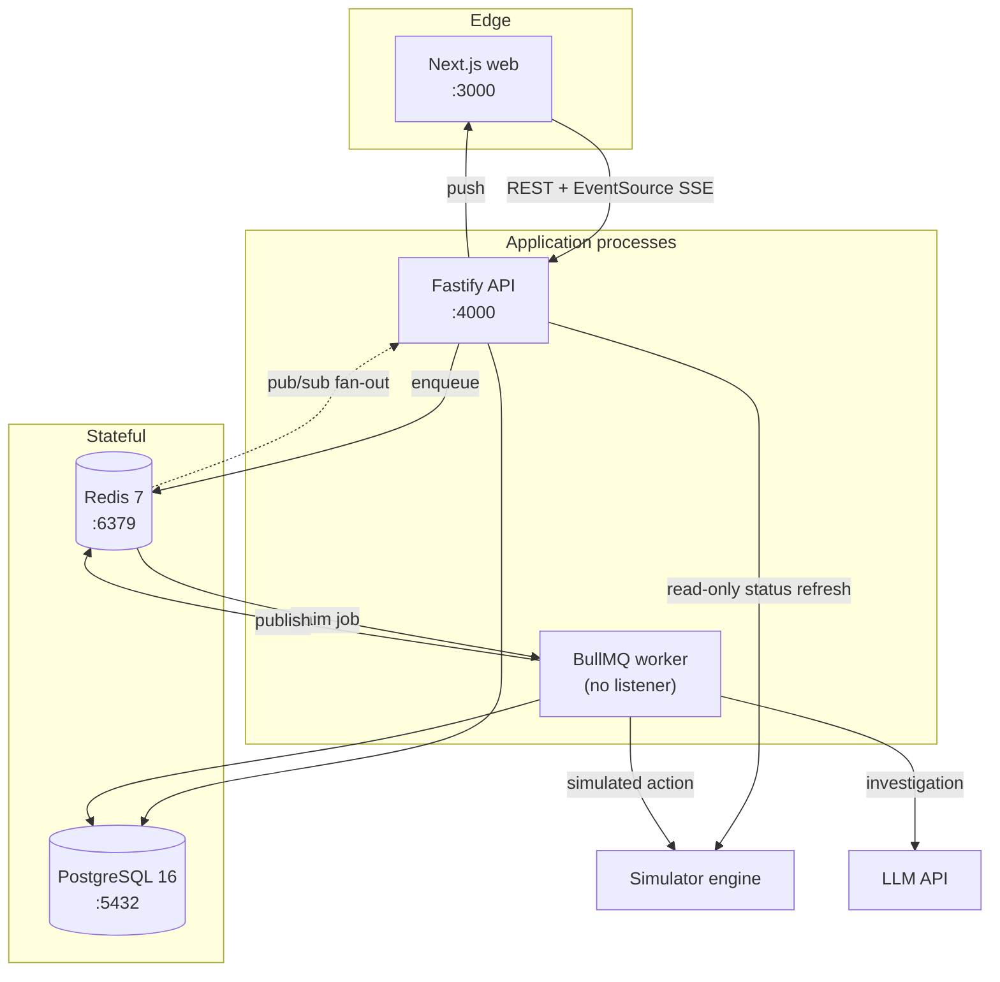
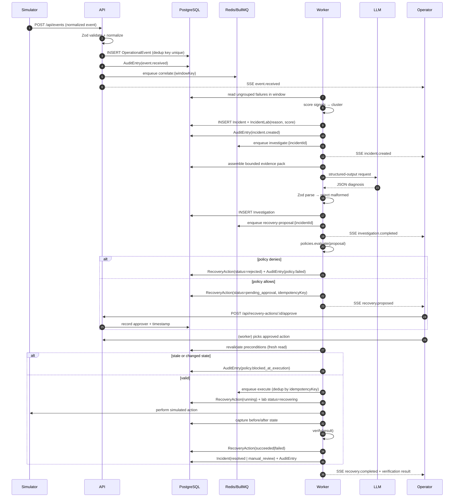
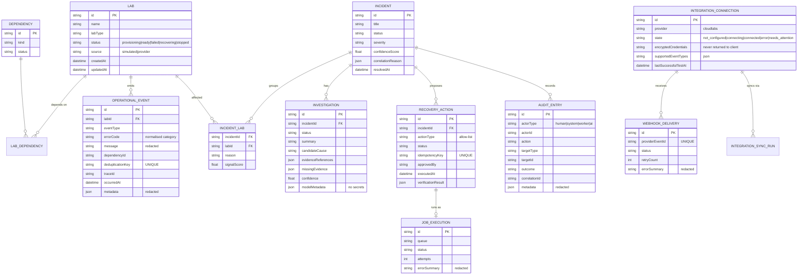
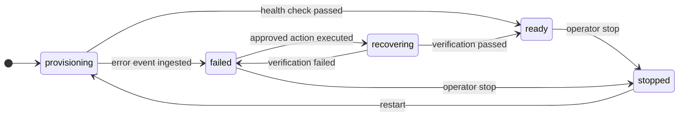
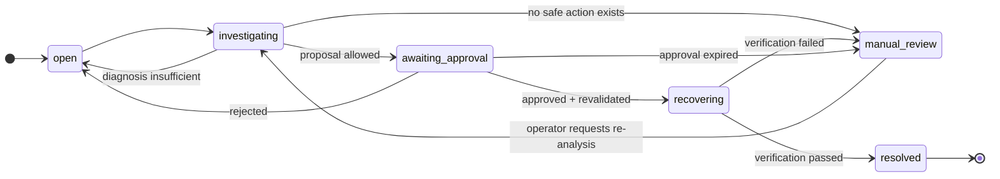
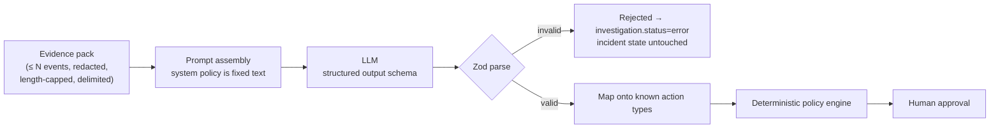
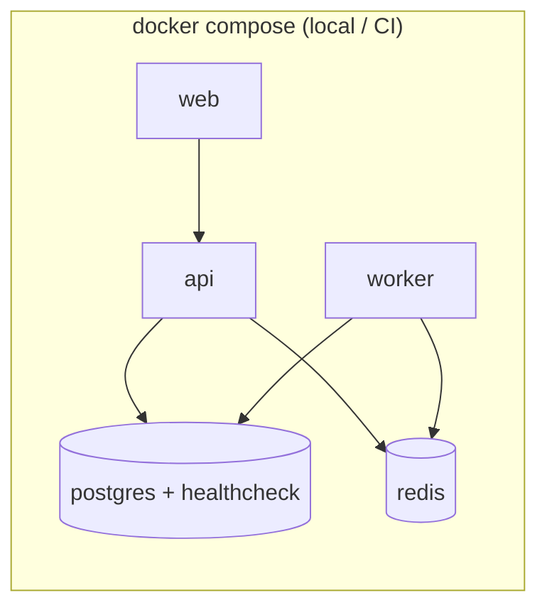

# LabOps Copilot — System Architecture

**Status:** Living document. Describes the target architecture and marks what is
already implemented.
**Last updated:** 13 October 2026
**Scope:** Incident correlation, evidence-backed AI investigation, policy-gated
recovery orchestration and verification for cloud lab operations.

> **Important framing.** All lab infrastructure in this system is **simulated**.
> There is no live CloudLabs connection in the MVP. The integration layer exists
> as a provider-neutral adapter so a verified connector can be added later
> without changing the pipeline. See
> [Integration gate](#13-integration-gate--cloudlabs).

---

## 1. Design principles

These principles drive every decision below. They are the answer to
"why is it built this way?" in the interview.

| # | Principle | Consequence |
|---|---|---|
| 1 | **AI is untrusted input, not an authority** | The LLM may *propose*. A deterministic policy engine and a human *decide*. No model output reaches an executor without passing Zod validation, a policy check and an approval record. |
| 2 | **Correlation is deterministic and explainable** | Grouping uses scored rules with recorded rationale. The LLM may explain or suggest extra hypotheses, but it never merges labs into an incident. |
| 3 | **Durable business state lives in Postgres, not Redis** | Redis is a transport for jobs. Every state transition that matters is a committed row, so a worker crash cannot lose or duplicate an incident or a recovery. |
| 4 | **Side effects are idempotent by construction** | Every command carries an idempotency key backed by a unique DB constraint. Repeat clicks, redelivered webhooks and worker retries converge to one effect. |
| 5 | **Modular monolith, explicit seams** | One deployable API + one worker process, with a provider interface where a second implementation is genuinely expected. Modules are separated by responsibility, not by network hop. |
| 6 | **Simulated means visibly simulated** | Simulator data is labelled in the UI, in logs and in payloads. A reviewer must never mistake a simulation for a live system. |
| 7 | **Never store what you cannot explain** | No secrets in logs, prompts, URLs or API responses. Redaction happens at the boundary, not at the log formatter. |

---

## 2. System context


**Trust boundaries**

1. **Browser → API** — untrusted. All bodies validated, all writes authorised.
2. **Provider → API (webhook)** — untrusted. Signature/token verified, replay
   window enforced, size and rate limited, payload normalised then redacted.
3. **Logs/event text → LLM** — untrusted *data*. Delimited, length-bounded,
   never concatenated into system instructions.
4. **LLM → policy engine** — untrusted *proposal*. Structurally validated and
   mapped onto an allow-list of known action types.
5. **API → simulator** — trusted internal. The only component permitted to
   mutate simulated lab state, and only through a narrow interface.

---

## 3. Runtime topology

Four processes. `api` and `worker` share one TypeScript codebase and one Prisma
schema; they are separate OS processes so long-running jobs never occupy the
HTTP request lifecycle.



**Ports and responsibilities**

| Process | Port | Owns | Must not |
|---|---|---|---|
| `web` | 3000 | SSR shell, operator UI, SSE consumer | Hold credentials or secrets in browser storage |
| `api` | 4000 | HTTP surface, validation, authorisation, enqueue, SSE fan-out | Execute long-running work inline |
| `worker` | — | Correlation, investigation, recovery execution, verification | Serve HTTP |
| `postgres` | 5432 | All durable business state | — |
| `redis` | 6379 | Queue transport, SSE pub/sub, short-lived locks | Be the source of truth for business state |

### Why SSE and not WebSockets

The dashboard needs server→client push only; the client sends actions over
ordinary REST. SSE is plain HTTP, survives proxies, reconnects automatically in
the browser, and needs no additional infrastructure or library. The cost is that
it cannot carry client→server messages — which this product does not need.

---

## 4. Backend module map

Logical modules inside the API/worker codebase. Each owns its tables and
exposes behaviour, not tables, to other modules.

```
apps/api/src/
  index.ts            process bootstrap, graceful shutdown
  app.ts              Fastify assembly, plugins, error handler
  config/             env parsing (Zod), feature flags
  observability/      Pino logger, OTel bootstrap, metrics, correlation IDs
  secrets/            envelope encryption, redaction helpers, key rotation
  labs/               Lab model, lifecycle state machine, simulator engine
  events/             normalisation, Zod schemas, dedup, ingestion queries
  integrations/       provider interface, simulator adapter, CloudLabs adapter,
                      connection settings, webhook receiver, sync jobs
  incidents/          correlation engine, incident lifecycle, evidence assembly
  investigations/     LLM provider abstraction, prompt assembly, output schemas
  policies/           action allow-list, preconditions, retry/cooldown limits
  approvals/          approve/reject, staleness, revalidation at exec time
  jobs/               BullMQ queue definitions, worker bootstrap, handlers
  recovery/           simulated action execution + post-action verification
  audit/              append-only audit writer + queries
  events-stream/      SSE hub, per-subscriber filtering
```

**Dependency rule:** modules may depend *downward* only —
`recovery → policies → approvals → incidents → events → labs`.
`audit`, `observability` and `jobs` are cross-cutting and depend on nothing
above them. Circular imports are a build error, enforced by an ESLint
`import/no-cycle` rule.

### Frontend structure

```
apps/web/src/app/
  (dashboard)/            overview, incidents, labs, jobs, audit
    incidents/[id]/       timeline, evidence, correlation rationale,
                         investigation, approval, execution, audit
    integrations/cloudlabs/
  api/                    thin BFF route handlers (server-side proxy + auth)
  components/             ui primitives (shadcn), panels, graph (React Flow)
  lib/                    SSE client, fetch client, formatters, types
```

The browser never talks to PostgreSQL, Redis or the LLM directly. It calls the
API; `NEXT_PUBLIC_*` variables hold URLs only.

---

## 5. Core data flow — the incident lifecycle

The single most important sequence in the system. Each step is a committed
transaction plus an audit entry; nothing depends on in-memory state surviving.



---

## 6. Data model



### Invariants enforced by the database, not by application code

| Invariant | Mechanism |
|---|---|
| One effect per logical event | `UNIQUE(OperationalEvent.deduplicationKey)` |
| One execution per approved action | `UNIQUE(RecoveryAction.idempotencyKey)` + partial unique index on in-flight job |
| One incident per correlation window key | `UNIQUE(Incident.windowKey)` for open incidents |
| Audit history is append-only | No `UPDATE`/`DELETE` path on `AuditEntry`; role restricted |
| State transitions are legal | Guarded transition function + `CHECK`-constrained status enums |
| Concurrent approvals cannot both win | `SELECT ... FOR UPDATE` on the action row inside the transaction |

Durability note: `JobExecution` rows mirror queue state so that a Redis flush
does not erase the business history, and the worker reconciles orphaned
`running` rows on startup.

---

## 7. State machines

Explicit transitions, not scattered status writes. Every transition is a single
transaction that also writes an audit entry.





Legal transitions are declared as data (`INCIDENT_TRANSITIONS`) and shared by
the API, the worker and the tests, so a forbidden transition fails the same way
in every context.

---

## 8. Correlation engine

Correlation answers *"do these failures belong together?"* — **not** *"why did
this fail?"*. Root-cause reasoning is the LLM's job; grouping is a scored,
auditable function. Keeping these apart is what makes the system explainable.

### Signals and weights

| Signal | Weight | Rationale |
|---|---:|---|
| Identical normalised error category | 0.30 | Strongest single indicator |
| Shared dependency ID | 0.30 | Two labs failing on one dependency are usually one incident |
| Temporal proximity (within window) | 0.20 | Burst failures correlate |
| Identical preceding event sequence | 0.10 | Corroborating, weak alone |
| Same state transition pattern | 0.05 | Weak |
| Same lab type / image version | 0.05 | Weak |

Link candidates are generated by inverted indices on `(errorCategory)`,
`(dependencyId)` and `(timeBucket)` — so cost is near-linear in events rather
than quadratic. Candidate pairs are scored, then agglomerated into clusters by
a deterministic threshold, with **single-link chaining blocked**: a lab joins a
cluster only if it scores above the threshold against the cluster's anchor, not
merely against one member. That rule is what stops unrelated failures from
chaining into one meaningless mega-incident.

### Guard rails

- Raw error strings are **never** used alone; only normalised categories
  (`PROVISION_TIMEOUT`, `PERMISSION_DENIED`, `NETWORK_CONFIG`, …).
- Every `IncidentLab` row stores *why* it was included and with what score, and
  the UI renders that rationale verbatim.
- `confidenceScore` is labelled as correlation strength, never as certainty.
- Correlation is re-runnable and idempotent: it upserts against the window key
  and never duplicates incidents on re-processing.

---

## 9. AI boundary

The model is a **bounded analyst**, never an actor.



**Rules enforced in code**

1. Evidence is assembled server-side from a fixed query — the model never
   receives "all logs", and never selects its own context.
2. Event text is placed in an explicitly delimited data block. A payload
   containing something like `ignore previous instructions` is inert text; the
   system policy and tool allow-list are not model-controlled.
3. Output is validated against a strict Zod schema. Unknown fields are
   rejected, not coerced. Enums are closed sets.
4. The returned `recommendedAction` is a **string enum**. Anything outside the
   allow-list is dropped before it reaches the policy engine.
5. The model cannot name a target outside the incident's own affected labs;
   targets are intersected with server-side truth, so a hallucinated lab ID is
   discarded rather than executed.
6. Model failure is non-destructive: a timeout, malformed response or refusal
   leaves the incident in `open` with an audit entry, never a partial state.
7. Secrets, tokens and full raw payloads never enter a prompt. Redaction runs
   before assembly, and the evidence pack records its own redaction summary.
8. The provider sits behind an interface (`LlmProvider.analyse()`) so tests use
   a deterministic fixture provider and CI never depends on a live model.

---

## 10. Safety model for recovery

### Action allow-list

The only executable actions are predefined, parameterised operations:

| Action | Preconditions | Guards |
|---|---|---|
| `RETRY_PROVISIONING` | lab in `failed`; no in-flight job for that lab; attempts < max; cooldown elapsed | idempotency key per incident+action+attempt-window |
| `RECHECK_DEPENDENCY` | dependency referenced by the incident's labs | read-only, always safe |
| `RERUN_VALIDATION` | lab in `failed` or `ready` | bounded retries |
| `ESCALATE_MANUAL` | none | always allowed, no side effects |

Anything not in this table is rejected with a recorded reason. There is no
generic "run this command" path anywhere in the codebase.

### Policy evaluation order

1. **Structural** — action type in allow-list; parameters match schema.
2. **Target validity** — every target exists, and belongs to the incident.
3. **State** — lab/dependency/job currently in an eligible state.
4. **Concurrency** — no running job for the same target; row locked.
5. **Rate limits** — per-action attempt caps and cooldown windows.
6. **Authorisation** — approval present, granted by an authorised actor,
   not expired.
7. **Idempotency** — key unused; if used, return the prior result instead of
   re-executing.

Each step appends a decision with its reason, so the audit trail can explain
exactly *which* rule blocked an action and why.

### Staleness and TOCTOU

Approval is not permission to execute — it is permission to *re-validate*. The
worker re-reads lab state, job state and attempt counters inside the execution
transaction. If anything changed since approval, the action is blocked and the
operator is notified. An approval older than a configured TTL expires
automatically.

---

## 11. Reliability, idempotency and failure handling

| Failure | Behaviour |
|---|---|
| Duplicate event delivery | Dedup key insert conflicts → acknowledged as duplicate, no second processing |
| Duplicate API request | Idempotency key conflict → returns original result |
| Worker crash mid-job | Row stays `running`; startup reconciliation re-queues or marks `failed` after a lease timeout |
| Queue job exceeds retries | Marked `failed`, incident moves to `manual_review`, audit entry records final error |
| LLM timeout / malformed output | Investigation marked `error`; incident unchanged; retried with backoff |
| DB unavailable | API reports `degraded` via `/health`; writes fail closed rather than silently dropping events |
| SSE client disconnects | No effect on processing; stream resumes from last event ID |

BullMQ jobs carry a stable `jobId` derived from the idempotency key, so
duplicate enqueues collapse into one job rather than racing.

Long-running work is never inline: HTTP handlers validate, persist and enqueue,
then return `202 Accepted` with the job id. The dashboard follows progress over
SSE, so a request never blocks on investigation or recovery.

---

## 12. Observability

Three signals, one correlation ID.

**Logs** — Pino, JSON, request-scoped; Fastify shares the same instance.
Secrets are removed where data enters the system (principle 7). The logger adds
a safety net behind that: a key-name redaction step (any depth, any casing)
catches a forgotten `logger.info(payload)` that carries a secret-named key. It
cannot catch a secret under an innocuous key or inside a message string, which
is why it is the net and not the control. Child loggers carry `correlationId`,
`traceId`, `incidentId`.

**Traces** — OpenTelemetry spans per the spec's vocabulary, propagated across
the API→queue→worker boundary via span context embedded in job payloads, so one
incident is a single trace even though it spans processes and minutes.

```
event.ingest → incident.correlate → investigation.queue → investigation.llm
             → recovery.policy_check → recovery.execute → recovery.verify
```

**Metrics** — events ingested, candidate incidents created, correlation
duration, queue depth and job latency, AI success/failure and latency, recovery
success rate, retry count, time-to-first-incident, time-from-approval-to-verified.

All demo numbers come from real runs. No fabricated dashboards.

---

## 13. Integration gate — CloudLabs

The adapter interface exists; the live implementation does not, and will not
be written speculatively.

```ts
interface ProviderAdapter {
  testConnection(cfg: ProviderConfig): Promise<ConnectionResult>;
  fetchLabs?(cfg: ProviderConfig): Promise<NormalizedLab[]>;
  fetchStatuses?(cfg: ProviderConfig, cursor?: string): Promise<Page<NormalizedLab>>;
  registerWebhook?(cfg: ProviderConfig, target: WebhookTarget): Promise<void>;
  normalizeIncomingEvent(raw: unknown, headers: Headers): NormalizedEvent;
  readonly supportedEventTypes: string[];
  readonly capabilities: ProviderCapabilities;
}
```

Optional methods are genuinely optional. `capabilities` is queried at runtime,
and the UI renders only what the adapter reports — unverified event types are
never shown as available.

**Gate before any live code:** official API documentation obtained, auth scheme
and scopes confirmed, sandbox tenant or sample payloads supplied, webhook
security model documented, rate limits known, permitted operations confirmed.
Absent that, the adapter stays in `simulated` mode and the connection reads
`not_configured`. The product never claims a connection it has not tested.

**Credential handling:** submitted server-side over HTTPS → envelope-encrypted
at rest with a key from the environment → never returned by any endpoint →
never logged → redacted from all AI context. Least privilege and read-only by
default; real recovery actions remain disabled behind a separately reviewed,
sandboxed flag.

External payloads enter the *same* normalisation path as simulator events, so
the correlation, investigation and recovery pipeline is identical whether data
is simulated or live. That is the whole point of the adapter boundary.

---

## 14. Security model

| Threat | Control |
|---|---|
| Prompt injection via log text | Delimited data block, fixed system policy, closed action enum, server-side target intersection |
| Model-invented action | Zod schema + allow-list + policy engine; executor accepts only enum values |
| Secrets in logs / prompts / responses | Redaction at serializer and assembly boundaries; no endpoint returns credentials |
| Forged webhook | Documented signature/token verification, timestamp replay window, rate and size limits |
| Duplicate or replayed write | Unique dedup and idempotency keys; duplicate returns prior result |
| Stale approval replay | TTL + precondition revalidation inside the execution transaction |
| Unauthorised approval | Authenticated operator identity recorded on every approval; RBAC if time permits |
| Resource exhaustion | Body size limits, per-route rate limits, bounded queues, bounded retries, timeouts on all outbound calls |
| Demo endpoints in production | `/api/demo/*` gated behind a flag that is off outside local/demo environments |

---

## 15. Test architecture

Tests mirror the boundaries, so a failure points at a boundary.

| Layer | Scope | Doubles |
|---|---|---|
| Unit | Normalisation, dedup, correlation scoring, state transitions, policy decisions, retry/idempotency, AI schema validation | None — pure functions |
| Integration | Event ingestion → DB, ingestion → enqueue, worker retry/failure, approval + policy enforcement, execution + verification, audit writes | Real Postgres + Redis via testcontainers/compose |
| Contract | Adapter `capabilities` reporting, LLM output schema, webhook normalisation | Fixture payloads |
| E2E (Playwright) | Full operator journey, plus the negative cases | Mock LLM provider, seeded scenario |

Determinism rules: a fixed seed produces an identical 30-failure scenario
every run; the LLM is mocked in all CI tests with one opt-in job against a real
model; no test asserts on wall-clock timings or generated prose.

The negative suite is as important as the happy path: unrelated-but-similar
failures must **not** merge, malformed model output must be rejected, a
disallowed action must be blocked, a duplicate approval must not execute twice,
a stale approval must be revalidated, a failed recovery must not resolve the
incident, and no test output may contain a secret.

---

## 16. Deployment topology

**Local development** — `docker compose up`: postgres, redis, api, worker, web.
Web and api also run hot-reload outside containers for the dev loop; compose is
the reproducible baseline and the CI environment.



**CI (GitHub Actions)** — three workflows:

`changes.yml` is the only entry point. It uses `dorny/paths-filter` to decide
whether a commit touched `apps/web`, `apps/api`, or shared root tooling, then
dispatches only the matching pipeline via `workflow_call`. A frontend-only
change never starts the backend pipeline. Root manifests and the ESLint config
map to **both** services, because a shared-tooling change can break either.

`api.yml` — build (`tsc` plus `prisma validate`), lint, unit tests, integration
tests against real PostgreSQL and Redis service containers, coverage with
thresholds, quality gate. `web.yml` — build, lint, unit tests, coverage with
thresholds, quality gate.

Two design points worth calling out, because the obvious version of both is
broken:

- **The quality gate uses `if: always()`.** A gate that only runs when its
  dependencies passed is unreachable exactly when it is needed — GitHub already
  fails the workflow when a `needs` job fails, so such a gate never executes a
  single assertion. Running unconditionally makes it the one place that always
  reports the pipeline's state, and lets it own the checks that span jobs.
- **The dependency audit is a baseline gate, not a boolean.** `npm audit` cannot
  reach zero here: prisma 7, vitest 5 and next 16 are all major upgrades. The
  six known advisories are recorded in `.github/audit-baseline.json` with a
  reason and a review date, and the gate fails on anything *new*. A non-blocking
  audit step would be a gate in name only.

Gates are split by ownership: checks that belong to one job run in that job
(lint, coverage thresholds), and checks that span the pipeline run in the gate
(secret scan, dependency audit, required-script contract).

Deploy only from protected `main`, and only if a target exists.

**Production shape** — same containers, managed Postgres and Redis, TLS
terminated at the edge, secrets injected from the platform's secret store,
observability backend receiving OTel export, demo endpoints disabled, database
role for the app restricted to its own schema.

---

## 17. Implementation status

Phases refer to `docs/specs/labops-copilot/PLAN.md`.

| Layer | State | Next |
|---|---|---|
| npm workspaces, root scripts | Done | — |
| Next.js shell + layout | Done | Dashboard routes (Phase 12) |
| Fastify app, CORS, `/health`, `/api/labs` | Done | View types and pagination (Phase 1) |
| Zod config validation, error envelope, body limit | Done (Phase 0) | — |
| Prisma `Lab` model, checked-in migrations, drift check | Done (Phase 0) | Full schema per §6 (Phases 1–13) |
| Compose: postgres, redis, migrate, api, web | Done, verified end to end | Worker service (Phase 4) |
| Pino with shared Fastify instance and key-name redaction | Done | Child-logger context (Phase 4) |
| Vitest unit + integration suites, CI gates | Done | Playwright (Phase 14) |
| CI: change detection, build, lint, tests, coverage, quality gate | Done | Release and deploy (Phase 15) |
| Audit trail | Not started | Phase 1 |
| Labs simulator | Not started | Phase 2 |
| Event ingestion + dedup | Not started | Phase 3 |
| BullMQ worker, OTel tracing | Not started | Phase 4 |
| Correlation engine | Not started | Phase 5 |
| AI investigation | Not started | Phases 7, 11 |
| Policies, approvals, execution, verification | Not started | Phases 8–9 |
| SSE, dashboard, React Flow | Not started | Phases 10, 12, 15 |
| Integrations (adapter, settings, secrets) | Not started | Phase 13 |

Build order follows the spec's phases: vertical slice first — simulator →
events → correlation → investigation → recovery → verification — so a working
end-to-end workflow exists before breadth is added.

---

## 18. Architectural trade-offs

| Decision | Chosen | Rejected | Why |
|---|---|---|---|
| Service granularity | Modular monolith + separate worker | Microservices | No independent scaling or team boundary to justify the network cost; seams are kept so extraction stays possible. |
| Deployment units | API + worker processes | Single combined process | Workers must survive restarts and long jobs must not consume HTTP capacity; same codebase, different entrypoint. |
| Correlation | Deterministic scored rules | LLM clustering | Explanability and reproducibility; an operator must be able to see exactly why labs were grouped. |
| Action authority | LLM proposes, policy + human decide | LLM executes | Safety-critical decisions must be auditable and independent of model output. |
| Job durability | Postgres mirror + Redis transport | Redis as system of record | Redis eviction must never erase business history. |
| Real-time | SSE | WebSockets | One-directional push; no extra infra, native browser reconnect. |
| Context passing | Trace context in job payloads | Fire-and-forget enqueue | One incident must resolve to one trace. |
| Long jobs | `202` + enqueue | Inline execution | Request timeouts, retries and duplicate submissions handled at the queue. |
| Data access | Prisma | Raw SQL / Kysely | Type-safe schema-first, single migration story; raw SQL still allowed for reporting queries. |
| AI orchestration | Explicit state machine | LangGraph.js | The workflow is linear with two conditional branches; a framework would add indirection without capability. Revisit only if multi-step branching with persistence becomes real. |
| Secrets | Envelope encryption with env-held key | Plaintext in DB, external KMS | No external dependency for a local demo, while keeping a clean upgrade path to a KMS. |
| Migrations | Checked-in `prisma migrate` migrations everywhere, plus a CI drift check | `prisma db push` | Partial unique indexes, CHECK constraints and the append-only audit trigger need raw SQL that `db push` cannot express; one schema path for local, CI and compose. |

---

## 19. Open questions

1. **CloudLabs API contract** — auth, endpoints, event types, webhook security,
   rate limits. Blocks F2a beyond the adapter interface.
2. **Sandbox access** — a test tenant or sample payloads. Until then the
   simulator is the only data source.
3. **AI provider and budget** — provider choice plus a quota-safe local mode so
   development never depends on a paid subscription.
4. **Authentication depth** — a simple operator identity is sufficient for the
   MVP; explicit RBAC is a stretch goal.
5. **Retention** — how long to keep raw event payloads. Default is metadata and
   redacted excerpts only, with raw retention opt-in and time-boxed.
6. **Deployment target** — decides whether the pipeline deploys or only builds
   and publishes images.