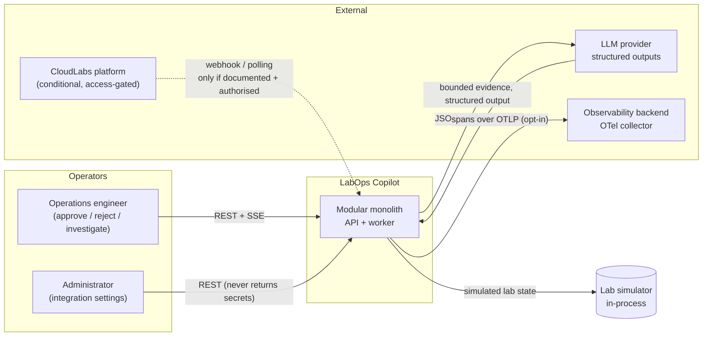
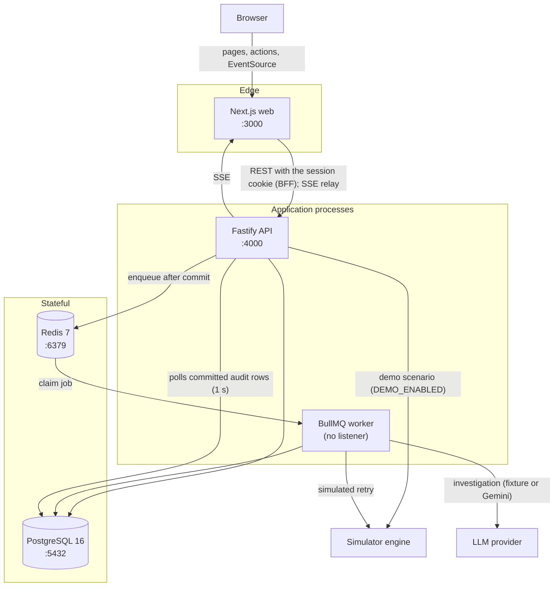
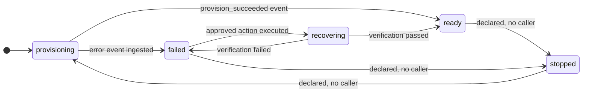
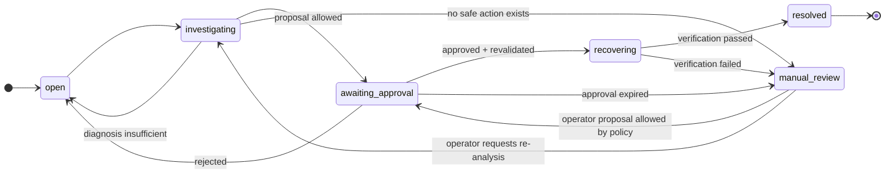
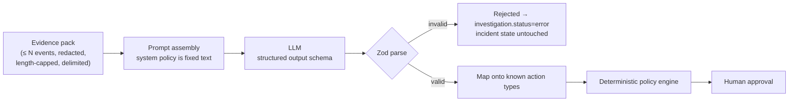
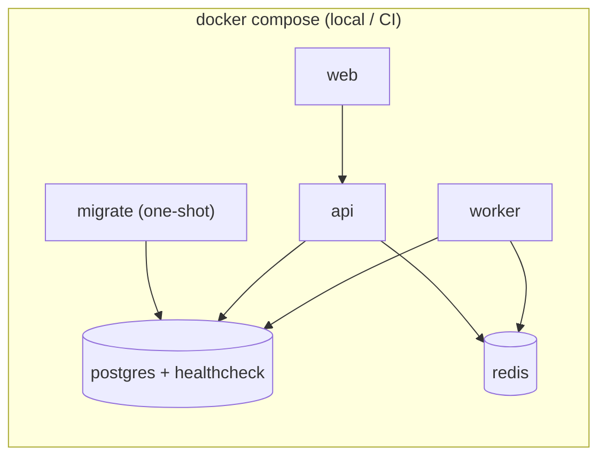

# LabOps Copilot — System Architecture

**Status:** Describes the system as built (all phases complete). Anything not
built is marked as such.
**Last updated:** 15 October 2026
**Scope:** Incident correlation, evidence-backed AI investigation, policy-gated
recovery orchestration and verification for cloud lab operations.

> **Important framing.** All lab infrastructure in this system is **simulated**.
> There is no live CloudLabs connection in the MVP. The integration layer exists
> as a provider-neutral adapter so a verified connector can be added later
> without changing the pipeline. See
> [Integration gate](#13-integration-gate--cloudlabs).

---

## 1. Design principles

These principles drive every decision below. They are the answer to
"why is it built this way?" in the interview.

| # | Principle | Consequence |
|---|---|---|
| 1 | **AI is untrusted input, not an authority** | The LLM may *propose*. A deterministic policy engine and a human *decide*. No model output reaches an executor without passing Zod validation, a policy check and an approval record. |
| 2 | **Correlation is deterministic and explainable** | Grouping uses scored rules with recorded rationale. The LLM may explain or suggest extra hypotheses, but it never merges labs into an incident. |
| 3 | **Durable business state lives in Postgres, not Redis** | Redis is a transport for jobs. Every state transition that matters is a committed row, so a worker crash cannot lose or duplicate an incident or a recovery. |
| 4 | **Side effects are idempotent by construction** | Every command carries an idempotency key backed by a unique DB constraint. Repeat clicks, redelivered webhooks and worker retries converge to one effect. |
| 5 | **Modular monolith, explicit seams** | One deployable API + one worker process, with a provider interface where a second implementation is genuinely expected. Modules are separated by responsibility, not by network hop. |
| 6 | **Simulated means visibly simulated** | Simulator data is labelled in the UI, in logs and in payloads. A reviewer must never mistake a simulation for a live system. |
| 7 | **Never store what you cannot explain** | No secrets in logs, prompts, URLs or API responses. Redaction happens at the boundary, not at the log formatter. |

---

## 2. System context



**Trust boundaries**

1. **Browser → API** — untrusted. All bodies validated, all writes authorised.
2. **Provider → API (webhook)** — untrusted. **Not built:** the integration gate
   is closed (§13). When it opens: signature or token verified, replay window
   enforced, size and rate limited, payload normalised then redacted.
3. **Logs/event text → LLM** — untrusted *data*. Delimited, length-bounded,
   never concatenated into system instructions.
4. **LLM → policy engine** — untrusted *proposal*. Structurally validated and
   mapped onto an allow-list of known action types.
5. **API and worker → simulator** — trusted internal. Only the flag-gated demo
   route (creating a scenario) and the recovery executor (a simulated retry)
   change simulated lab state, through the labs module's narrow interface.

---

## 3. Runtime topology

Five long-running processes, plus a one-shot `migrate` that applies migrations
and seeds the demo operator before the api starts. `api` and `worker` share one
TypeScript codebase and one Prisma schema; they are separate OS processes so
long-running jobs never occupy the HTTP request lifecycle.



**Ports and responsibilities**

| Process | Port | Owns | Must not |
|---|---|---|---|
| `web` | 3000 | Server-rendered operator UI, session cookie (BFF), SSE relay | Let the browser call the API, or hold credentials in browser storage |
| `api` | 4000 | HTTP surface, validation, authorisation, enqueue, SSE | Execute long-running work inline |
| `worker` | — | Correlation, investigation, recovery execution, verification | Serve HTTP |
| `postgres` | 5432 | All durable business state | — |
| `redis` | 6379 | Queue transport, login rate-limit counters | Be the source of truth for business state |

### Why SSE and not WebSockets

The dashboard needs server→client push only; the client sends actions over
ordinary REST. SSE is plain HTTP, survives proxies, reconnects automatically in
the browser, and needs no additional infrastructure or library. The cost is that
it cannot carry client→server messages — which this product does not need.

### How live updates stay gap-free (Phase 10)

The stream (`GET /api/events/stream`) is the tail of **committed** audit
entries; it needs no publisher, so no code path can forget to publish.

- Each `AuditEntry` records the id of the transaction that wrote it (`xid8`,
  set by the database). A row is read only once it is below
  `pg_snapshot_xmin`, the oldest running transaction: it is final, and so is
  everything before it. A rolled-back write never appears.
- `seq` is **not** used to resume: it follows insertion, and transactions
  commit out of `seq` order, so "`seq > N`" can skip a row that commits late.
  The SSE message id is the transaction boundary instead, and `Last-Event-ID`
  replays exactly what committed after it (over 500 behind: a `reset` event,
  reload). The id goes on a batch's last message, so a client cut off
  mid-batch repeats rather than skips: at-least-once.
- One poller per API process serves every open stream (1 s), and runs only
  while someone listens. The heartbeat (15 s) re-checks the session and ends
  the stream once it is revoked.
- The browser's `EventSource` talks to the web server, which relays the stream
  with the session cookie (BFF). Events carry action, target, outcome and the
  incident id, never metadata; pages treat them as "refresh now".
- Cost: a transaction left open anywhere on the database holds every event
  back until it finishes. Ours are short; long-running work never holds one.

---

## 4. Backend module map

Logical modules inside the API/worker codebase. Each owns its tables and
exposes behaviour, not tables, to other modules.

```
apps/api/src/
  index.ts            process bootstrap, graceful shutdown
  app.ts              Fastify assembly, plugins, error handler
  config/             env parsing (Zod), feature flags
  http/               the shared error envelope
  auth/               operators, scrypt hashing, server-side sessions,
                      deny-by-default route guard, login rate limit
  observability/      Pino logger, key-name redaction, OTel bootstrap and span
                      helpers, shared metric shapes
  secrets/            AES-256-GCM sealing with a key from the environment;
                      keyVersion on each row leaves room for rotation
  labs/               Lab model, lifecycle state machine, simulator engine
  events/             normalisation, Zod schemas, dedup, ingestion queries
  integrations/       provider interface, simulator adapter, CloudLabs adapter
                      (no capabilities: the gate is closed), connection settings
  incidents/          correlation engine, incident lifecycle and transitions
  investigations/     evidence assembly, LLM providers (fixture, Gemini),
                      prompt, strict output schema, investigate job
  policies/           pure policy evaluator: allow-list, the seven steps,
                      preconditions, retry and cooldown limits
  jobs/               BullMQ queues, outbox job rows, runner, reconciler
  recovery/           proposals, approve/reject, expiry sweep, execution with
                      revalidation, post-action verification
  audit/              append-only audit writer + queries
  events-stream/      committed-audit feed (xid8 boundary), one poller per
                      process, SSE route with Last-Event-ID replay
  metrics/            GET /api/metrics: combines each module's stats.ts, which
                      derives its own figures from its own committed rows
  demo/               flag-gated scenario trigger (DEMO_ENABLED); calls the
                      labs service, never touches real provider data
  seed-operator.ts    one-shot: creates or resets the demo operator
  worker.ts           worker entrypoint: wires domain job handlers to jobs/;
                      jobs/ itself stays generic and imports no domain
```

**Dependency rule:** modules may depend *downward* only —
`investigations → recovery → {policies, incidents} → events → labs`.
`investigations` sits above `recovery` (a diagnosis is proposed in the same
transaction), and `policies` stays pure: it depends only on `labs`, and the
caller gathers every fact it judges.
`audit`, `observability`, `jobs` and `auth` are cross-cutting and depend on nothing
above them. `metrics` sits on top: it only reads, through each owner's stats. Circular imports are a build error, enforced by an ESLint
`import/no-cycle` rule.

### Frontend structure

```
apps/web/src/
  middleware.ts           no session cookie -> /login (the API still decides)
  app/
    layout.tsx            persistent "Simulated data" badge on every page
    login/                sign-in form + server action (BFF)
    (dashboard)/          overview (KPI tiles, charts, time window), incidents,
                          incidents/[id], audit, integrations (Settings);
                          server actions: investigate, approve, reject,
                          run demo, sign out; error state for bad responses
    api/events/stream/    SSE relay: forwards the session cookie to the API
  components/
    ui/                   shadcn primitives, copied into the repo
    shell/                sidebar, breadcrumbs, theme toggle
    dashboard/            KPI tile, failure timeline, labs donut, bar list
    live-refresh.tsx      one event stream per tab; refreshes on relevant events
  lib/                    API access (cookie forwarding), Zod response
                          schemas, formatters, URL query building
```

**The browser talks only to the web server (a BFF).** Sign-in runs as a
server action: the web server calls the API and copies its session token into
an httpOnly, SameSite=Lax cookie on the web origin. Pages (server components)
and actions (server actions, origin-checked by Next) forward that cookie to
the API over `API_INTERNAL_URL`. The browser never holds an API credential,
never makes a cross-origin call, and never talks to PostgreSQL, Redis or the
LLM; `NEXT_PUBLIC_*` variables hold URLs only. Every API response is
Zod-parsed; a malformed one shows an error state, never half-rendered data.
Pages refresh live from the event stream: one `LiveRefresh` in the dashboard
layout (one stream per tab across navigation) refreshes an incident page on its
own incident's events, other pages on any.

---

## 5. Core data flow — the incident lifecycle

The single most important sequence in the system. Each step is a committed
transaction plus an audit entry; nothing depends on in-memory state surviving.

```mermaid
sequenceDiagram
  autonumber
  participant O as Operator (web)
  participant API as API
  participant PG as PostgreSQL
  participant Q as Redis/BullMQ
  participant W as Worker
  participant L as LLM (fixture or Gemini)

  O->>API: POST /api/demo/scenarios/training-event (DEMO_ENABLED)
  API->>API: create simulated labs; per event: Zod validate, redact
  API->>PG: OperationalEvent (dedup key unique) + AuditEntry(event.received) + job row correlate:{window}
  API->>Q: enqueue after commit (2 s delay collapses a burst)

  Q->>W: correlate job
  W->>PG: read failures in the window, score against the anchor
  W->>PG: Incident (+ its traceparent) + IncidentLab(reason, score) + AuditEntry(incident.created)
  API-->>O: SSE: committed audit rows, polled from PG; the page refreshes

  O->>API: POST /api/incidents/:id/investigate
  API->>PG: incident → investigating, Investigation, job row, AuditEntry(investigation.requested)
  API-->>O: 202 with the job id
  Q->>W: investigate job (in the incident's trace)
  W->>PG: assemble the bounded, redacted evidence pack
  W->>L: delimited prompt
  L-->>W: JSON answer
  W->>W: strict Zod parse
  alt timeout, refusal, malformed or rejected output
    W->>PG: Investigation(error, failure) + incident → open + AuditEntry(investigation.failed)
  else valid diagnosis with a recommended action
    W->>W: policies.evaluate, proposal steps (same transaction)
    alt blocked
      W->>PG: RecoveryAction(rejected_by_policy, blockedAt) + incident → manual_review + AuditEntry(recovery.proposed)
    else allowed
      W->>PG: RecoveryAction(awaiting_approval, expiresAt) + incident → awaiting_approval + AuditEntry(recovery.proposed)
    end
  end

  O->>API: POST /api/recovery-actions/:id/approve
  API->>PG: lock the action (FOR UPDATE), check expiry, approved + job row execute:{action} + AuditEntry(recovery.approved)
  API-->>O: 202 with the job id
  Q->>W: execute job (in the incident's trace)
  W->>PG: re-run policy steps 3-7 on fresh state
  alt blocked at execution
    W->>PG: RecoveryAction(blocked) + incident → manual_review + AuditEntry(recovery.blocked)
  else still allowed
    W->>PG: RecoveryAction(running) + labs → recovering + AuditEntry(recovery.started)
    W->>W: simulated retry, outside any transaction
    W->>PG: re-read every incident lab: all ready → succeeded, incident resolved; else failed, manual_review + AuditEntry(recovery.verified)
  end
```

---

## 6. Data model

```mermaid
erDiagram
  LAB ||--o{ LAB_DEPENDENCY : "depends on"
  DEPENDENCY ||--o{ LAB_DEPENDENCY : ""
  LAB ||--o{ OPERATIONAL_EVENT : emits
  OPERATOR ||--o{ OPERATOR_SESSION : "signs in with"
  INCIDENT ||--o{ INCIDENT_LAB : groups
  LAB ||--o{ INCIDENT_LAB : affected
  INCIDENT ||--o{ INVESTIGATION : "has"
  INCIDENT ||--o{ RECOVERY_ACTION : "proposes"

  LAB {
    string id PK
    string name
    string labType
    string status "provisioning|ready|failed|recovering|stopped"
    string source "simulated|provider"
    datetime createdAt
    datetime updatedAt
  }
  DEPENDENCY {
    string id PK
    string kind
    string status
  }
  OPERATIONAL_EVENT {
    string id PK
    string labId FK
    string type "provision_succeeded|provision_failed"
    string errorCategory "closed enum; CHECK: set iff failed"
    string message "redacted at entry"
    string dependencyId FK "SET NULL on delete"
    string deduplicationKey "UNIQUE"
    string source "simulated|provider"
    datetime occurredAt
    json metadata "redacted at entry"
  }
  INCIDENT {
    string id PK
    string title
    string status "open|investigating|awaiting_approval|recovering|resolved|manual_review"
    string severity "low|medium|high, by lab count"
    string windowKey "anchor:<eventId>; UNIQUE while unresolved"
    string anchorEventId FK "earliest failure"
    float confidenceScore "correlation strength; null when alone"
    json correlationReason "summary, threshold, weights, near miss"
    string traceparent "the trace it was born in; later steps join it"
    datetime resolvedAt
  }
  INCIDENT_LAB {
    string incidentId FK
    string labId FK
    string eventId FK "the failure that put it here"
    string reason "shown verbatim"
    float signalScore "null for the anchor"
    json signals "per-signal breakdown"
  }
  OPERATOR {
    string id PK
    string username "UNIQUE"
    string passwordHash "scrypt; never returned or logged"
  }
  OPERATOR_SESSION {
    string id PK "SHA-256 of the cookie token"
    string operatorId FK
    datetime expiresAt "8 h absolute"
    datetime revokedAt "set by logout or password reset"
  }
  INVESTIGATION {
    string id PK
    string incidentId FK "one pending/running per incident"
    string status "pending|running|completed|error"
    string requestedBy "operator id from the session"
    string outcome "diagnosis|insufficient_evidence"
    string summary
    string candidateCause
    string evidenceFor "text[]; event ids in the pack only"
    string evidenceAgainst "text[]"
    string missingEvidence "text[]"
    string diagnosticChecks "text[]"
    float confidence
    string recommendedAction "ActionType allow-list, nullable"
    string targetLabIds "text[]; cut to the incident's labs"
    string droppedTargets "text[]; what the model invented"
    json evidenceSummary "included, omitted, truncated, redacted"
    string failure "TIMEOUT|MALFORMED_OUTPUT|SCHEMA_REJECTED|TRUNCATED_OUTPUT|REFUSED|PROVIDER_ERROR|JOB_EXHAUSTED"
    json modelMetadata "provider, model, latency; no prompt, no secrets"
  }
  RECOVERY_ACTION {
    string id PK
    string incidentId FK
    string investigationId "null when an operator proposed it"
    string actionType "ActionType allow-list"
    string targetIds "text[]; GIN index"
    string status "rejected_by_policy|awaiting_approval|approved|rejected|expired|running|succeeded|failed|blocked"
    string idempotencyKey "UNIQUE: incident, action, targets hash, attempt"
    string proposedBy
    json policyDecisions "one {step, passed, reason} per step run"
    string blockedAt "the policy step that stopped it"
    datetime expiresAt "approval deadline"
    string approvedBy
    datetime executedAt
    json verificationResult
  }
  JOB_EXECUTION {
    string id PK
    string queue
    string jobKey "UNIQUE; also the BullMQ job id"
    string status "queued|running|succeeded|failed"
    int generation "bumped on every re-arm"
    int attempts
    string traceparent "the trace the job continues"
    string errorSummary "redacted"
  }
  AUDIT_ENTRY {
    string id PK
    bigint seq "UNIQUE, total order across processes"
    string actorType "human|system|worker|ai"
    string actorId
    string action
    string targetType
    string targetId
    string outcome
    string correlationId
    json metadata "redacted"
  }
  INTEGRATION_CONNECTION {
    string id PK
    string provider "cloudlabs"
    string state "not_configured|connecting|connected|error|needs_attention"
    string encryptedCredentials "AES-256-GCM; never returned to a client"
    int keyVersion "which key sealed it"
    string supportedEventTypes "json; only what a test confirmed"
    datetime lastSuccessfulTestAt
  }
```



### Invariants enforced by the database, not by application code

| Invariant | Mechanism |
|---|---|
| One effect per logical event | `UNIQUE(OperationalEvent.deduplicationKey)` |
| One execution per approved action | `UNIQUE(RecoveryAction.idempotencyKey)`, `UNIQUE(JobExecution.jobKey)` keyed by the action, and `FOR UPDATE` on approve |
| One incident per correlation window key | `UNIQUE(Incident.windowKey)` for unresolved incidents (partial index), behind an advisory lock that serialises correlation |
| One active investigation per incident | `UNIQUE(Investigation.incidentId)` while `pending`/`running` (partial index), behind the incident's compare-and-set move to `investigating` |
| Audit history is append-only | Triggers reject `UPDATE`, `DELETE` and `TRUNCATE` on `AuditEntry` |
| State transitions are legal | Guarded transition functions over Postgres `ENUM` statuses; a `CHECK` ties `errorCategory` to failed events |
| Concurrent approvals cannot both win | `SELECT ... FOR UPDATE` on the action row inside the transaction |

Durability note: `JobExecution` rows mirror queue state so that a Redis flush
does not erase the business history. The worker's reconciler runs at startup and
every 60 s, and re-sends `queued` or `running` rows idle past a 2-minute lease.

Not foreign keys: a recovery action finds its job by `jobKey`
(`execute:<actionId>`), and an incident's history is the audit rows that target
it or name it in `metadata.incidentId` (an expression index serves both).

---

## 7. State machines

Explicit transitions, not scattered status writes. Every transition is a single
transaction that also writes an audit entry.



The `stopped` transitions are declared in `LAB_TRANSITIONS` so the state space is
complete, but no route or job uses them yet.



Legal transitions are declared as data (`INCIDENT_TRANSITIONS`) and shared by
the API, the worker and the tests, so a forbidden transition fails the same way
in every context.

---

## 8. Correlation engine

Correlation answers *"do these failures belong together?"* — **not** *"why did
this fail?"*. Root-cause reasoning is the LLM's job; grouping is a scored,
auditable function. Keeping these apart is what makes the system explainable.

### Signals and weights

| Signal | Weight | Rationale |
|---|---:|---|
| Identical normalised error category | 0.30 | Strongest single indicator |
| Shared dependency ID | 0.30 | Two labs failing on one dependency are usually one incident |
| Temporal proximity | 0.20 | Burst failures correlate: full within 5 min, half within 15, none beyond |
| Identical preceding event sequence | 0.10 | Corroborating, weak alone. *Not yet scored:* simulated labs have one event each |
| Same state transition pattern | 0.05 | Weak. *Not yet scored*, for the same reason |
| Same lab type / image version | 0.05 | Weak |

A failure joins at **0.70 or more** (`incidents/scoring.ts`), which takes
category, dependency and closeness in time together; category alone, or
category and lab type, can never merge failures. Scores are rounded to two
decimals so operators read 0.85, not a float artefact.

Link candidates are generated by inverted indices on `(errorCategory)` and
`(dependencyId)` — so cost is near-linear in events rather than quadratic. No
time-bucket index is needed: the correlate job already loads a bounded window. Candidate pairs are scored, then agglomerated into clusters by
a deterministic threshold, with **single-link chaining blocked**: a lab joins a
cluster only if it scores at or above the threshold against the cluster's anchor, not
merely against one member. That rule is what stops unrelated failures from
chaining into one meaningless mega-incident.

### Guard rails

- Raw error strings are **never** used alone; only normalised categories
  (`PROVISION_TIMEOUT`, `PERMISSION_DENIED`, `NETWORK_CONFIG`, …).
- Every `IncidentLab` row stores *why* it was included and with what score, and
  the UI renders that rationale verbatim.
- `confidenceScore` is labelled as correlation strength, never as certainty.
- Correlation strength is the weakest member's score, not an average, so one
  borderline lab is never hidden behind strong ones.
- Each anchor records its best near miss (score and reasons), so an operator
  can see why a failure stayed apart.
- Correlation is re-runnable and idempotent: failures already in an incident
  are skipped, so re-processing creates nothing.

### The correlate job

A stored failure arms a correlate job for its ten-minute window (Phase 4).
The job (`incidents/correlate.job.ts`) runs in one transaction:

1. Takes a transaction-scoped advisory lock, so runs are serialised. Overlapping
   windows can choose different anchors for the same failure; the `windowKey`
   index alone would let both claim it.
2. Loads failures from one window before to two after, so a cluster that
   straddles a boundary still forms; drops any already in an incident, or whose
   lab is in an unresolved one.
3. Offers them first to incidents still `open` (an incident under investigation
   keeps the scope the operator is reviewing), then clusters the rest.
4. Writes each incident or added lab with its audit entry
   (`incident.created`, `incident.lab_added`) in the same transaction.

---

## 9. AI boundary

The model is a **bounded analyst**, never an actor.



**Rules enforced in code**

1. Evidence is assembled server-side from a fixed query — the model never
   receives "all logs", and never selects its own context.
2. Event text is placed in an explicitly delimited data block. A payload
   containing something like `ignore previous instructions` is inert text; the
   system policy and tool allow-list are not model-controlled.
3. Output is validated against a strict Zod schema. Unknown fields are
   rejected, not coerced. Enums are closed sets.
4. The returned `recommendedAction` is a **closed enum**. An answer naming an
   action outside the allow-list fails validation as a whole (`SCHEMA_REJECTED`)
   and never reaches the policy engine; the incident goes back to `open`.
5. The model cannot name a target outside the incident's own affected labs;
   targets are intersected with server-side truth, so a hallucinated lab ID is
   discarded rather than executed.
6. Model failure is non-destructive: a timeout, malformed response or refusal
   leaves the incident in `open` with an audit entry, never a partial state.
7. Secrets, tokens and full raw payloads never enter a prompt. Redaction runs
   before assembly, and the evidence pack records its own redaction summary.
8. The provider sits behind an interface (`LlmProvider.analyse()`) so tests use
   a deterministic fixture provider and CI never depends on a live model.


**How Phase 7 implements them** (`apps/api/src/investigations/`)

- The evidence pack (`evidence.ts`) holds at most 50 failures and 500
  characters per message, re-redacted; event metadata is never included.
- The `<evidence>` JSON escapes `<` and `>`, so a message containing
  `</evidence>` cannot end the block early (`prompt.ts`).
- `callProvider` enforces `LLM_TIMEOUT_MS` itself, racing the call against an
  `AbortSignal`, and classifies timeouts, refusals and provider errors.
- The output schema has no approval or authority field; a model that sends one
  fails validation (`output-schema.ts`).
- No transaction is open during the model call. The result and the incident's
  next state commit together behind a compare-and-set, so overlapping runs
  record one result.
- End states: a diagnosis with an action stays `investigating` for the policy
  step; `ESCALATE_MANUAL` or no action goes to `manual_review`; insufficient
  evidence and every model failure go back to `open`.


**How Phase 11 adds a real model** (`gemini-provider.ts`, `gemini-schema.ts`)

A second implementation of the same `LlmProvider` interface, selected by
`LLM_PROVIDER` and defaulting to `fixture`. It changes nothing about the
boundary above: the evidence still comes from the same server-side query, the
model output is still `unknown` until `output-schema.ts` accepts it, and a
rejection still leaves the incident in `open`.

The request schema is derived from the **same Zod schema the output is
validated against**, so the two cannot drift apart. `z.toJSONSchema()` emits a
superset of what the endpoint accepts, so `gemini-schema.ts` converts between
them and **refuses anything it cannot express** rather than sending a request
that would fail on the first real incident.

What the provider enforces, and what it does not:

| Constraint | Request side (Gemini) | Response side (Zod) |
|---|---|---|
| Field present, correct type | enforced | enforced |
| No unknown fields | **not enforced** (`additionalProperties` rejected by this endpoint) | enforced (`.strict()`) |
| Action is one of four names | **not enforced in practice** | enforced (closed enum) |
| Evidence ids within length | **not enforced** (`maxLength` unsupported) | enforced |
| Confidence within 0–1 | **not enforced** (`minimum`/`maximum` unsupported) | enforced |
| Array bounds | enforced (`maxItems`) | enforced |

This table is the argument for the whole design, and it was measured rather
than assumed. On a live run the model returned a full sentence where an event id
belonged and another where one of four enum values belonged, with the schema
accepted throughout. **Had this pipeline trusted `responseSchema` as its safety
boundary, a model would have handed it a free-text action.** Provider-side
structured output buys shape and token savings; Zod buys the guarantee.

Other decisions worth recording:

- **Plain `fetch`, no SDK.** One call site does not justify a dependency
  `CLAUDE.md` would ask us to justify. `LLM_BASE_URL` makes the choice
  reversible, and config refuses plaintext http to anything but loopback
  because the key rides in a request header.
- **The key is read once and used only as `x-goog-api-key`.** Never in a URL,
  never logged, never in `modelMetadata`, never in a prompt.
- **Retry covers 429 and 5xx only.** A 400 is a malformed request; resending it
  burns quota and delays the incident, so it fails on the first attempt.
- **`modelMetadata` records model, latency and token counts** — never the key.
- **CI never calls a model.** `vitest.config.ts` excludes `*.live.test.ts`, and
  `.github/workflows/llm-live.yml` is `workflow_dispatch` only, with no push or
  pull-request trigger. Provider throttling cannot break a merge.

---

## 10. Safety model for recovery

### Action allow-list

The only executable actions are predefined, parameterised operations:

| Action | Preconditions | Guards |
|---|---|---|
| `RETRY_PROVISIONING` | lab in `failed`; no in-flight job for that lab; attempts < max; cooldown elapsed | idempotency key per incident+action+attempt-window |
| `RECHECK_DEPENDENCY` | dependency referenced by the incident's labs | read-only, always safe |
| `RERUN_VALIDATION` | lab in `failed` or `ready` | bounded retries |
| `ESCALATE_MANUAL` | none | always allowed, no side effects |

Anything not in this table is rejected with a recorded reason. There is no
generic "run this command" path anywhere in the codebase.

### Policy evaluation order

1. **Structural** — action type in allow-list; parameters match schema.
2. **Target validity** — every target exists, and belongs to the incident.
3. **State** — lab/dependency/job currently in an eligible state.
4. **Concurrency** — no running job for the same target; row locked.
5. **Rate limits** — per-action attempt caps and cooldown windows.
6. **Authorisation** — approval present, granted by an authorised actor,
   not expired.
7. **Idempotency** — key unused; if used, return the prior result instead of
   re-executing.

Each step appends a decision with its reason, so the audit trail can explain
exactly *which* rule blocked an action and why.

### How Phase 8 implements it

- `policies/actions.ts` is the table above as data (targets, eligible lab
  states, categories an action cannot fix, attempt caps, cooldowns); a test
  fails if it, the enum and this table ever disagree.
- `policies/evaluate.ts` is pure: steps in fixed order, stopping at the first
  failure, one `{ step, passed, reason }` per step run. Proposals run steps
  1-5; execution re-runs 3-7.
- `recovery/propose.ts` locks the incident row, gathers facts, evaluates and
  records the result in one transaction. Allowed: `awaiting_approval` with an
  expiry. Blocked: `rejected_by_policy`, incident to `manual_review`. A repeat
  for the same action and targets returns the unfinished proposal.
- A retry on `PERMISSION_DENIED` is blocked at the state step: the demo's
  deterministic blocked case. The fixture model recommends exactly that retry
  for a permission failure, deliberately wrong as a real model can be, so the
  demo shows policy refusing a model rather than only a test doing so.
- Each source owns one starting state: a diagnosis proposes from
  `investigating` (which only the investigation leaves), an operator only from
  `manual_review`. Otherwise an operator proposal accepted mid-investigation
  could be orphaned when the investigation moved the incident on.

### Staleness and TOCTOU

Approval is not permission to execute — it is permission to *re-validate*. The
worker re-reads lab state, job state and attempt counters inside the execution
transaction. If anything changed since approval, the action is blocked and the
operator is notified. An approval older than a configured TTL expires
automatically.

### How Phase 9 implements it

- **Approve / reject** (`recovery/approve.ts`): `SELECT … FOR UPDATE` on the
  action; approve requires `awaiting_approval`, enforces `expiresAt` itself (a
  late click expires the action and gets 409), records the approver from the
  session and queues one execute job keyed by the action. Reject returns the
  incident to `open`. They live in `recovery/` because `RecoveryAction` is
  recovery's table.
- **Execute** (`recovery/execute.job.ts`), three steps:
  1. One transaction: re-run policy steps 3-7 against fresh state (the
     action's own row excluded from concurrency; approver and expiry
     re-checked). Changed means `blocked` with the step and reason, incident
     to `manual_review`. Otherwise `running`, retried labs to `recovering`,
     incident to `recovering`, lab states before stored.
  2. Outside any transaction: the simulated action
     (`labs/recovery-simulator.ts`, one outcome per failure category).
  3. One transaction behind a compare-and-set on `running`: apply, then
     **verify** by re-reading every lab in the incident. All `ready` means
     `resolved`; anything else is `manual_review`.
- Only a retry changes lab state, so a recheck or an escalation can never
  resolve an incident. The apply step moves only labs still `recovering`: a
  lab an ingested event moved meanwhile keeps that newer evidence
  (`verificationResult.changedByEvents`). A replay changes nothing, a crash after step 1 resumes,
  and an exhausted job fails the action and returns labs to `failed`.
- **Expiry sweep** (`recovery/expire.ts`) runs on the worker's 60 s tick with
  `FOR UPDATE SKIP LOCKED`; approve and execute check expiry too, so
  correctness never waits for it.
- Self-approval is allowed (one demo operator, no roles); proposer and
  approver are both audited.

---

## 11. Reliability, idempotency and failure handling

| Failure | Behaviour |
|---|---|
| Duplicate event delivery | Dedup key insert conflicts → acknowledged as duplicate, no second processing |
| Duplicate API request | Idempotency key conflict → returns original result |
| Worker crash mid-job | Row stays `running`; the reconciler (at startup, then every 60 s) re-sends `queued` or `running` rows idle past a 2-minute lease, or marks them `failed` once attempts are spent |
| Queue job exceeds retries | Marked `failed` with an audit entry; the queue's `onExhausted` hook runs in the same transaction (from the runner's last attempt and from the reconciler), so an investigation goes to `error` and its incident to `manual_review` |
| LLM timeout / malformed output | Investigation marked `error` with the reason; the incident goes back to `open` with an audit entry; nothing from the failed answer is stored. Not retried by the queue (a model's bad answer is a result); only Gemini's HTTP 429/5xx are retried, inside the provider |
| DB unavailable | API reports `degraded` via `/health`; writes fail closed rather than silently dropping events |
| SSE client disconnects | No effect on processing; stream resumes from last event ID |

BullMQ jobs carry a stable `jobId` derived from the idempotency key, so
duplicate enqueues collapse into one job rather than racing.

Long-running work is never inline: HTTP handlers validate, persist and enqueue,
then return `202 Accepted` with the job id. The dashboard follows progress over
SSE, so a request never blocks on investigation or recovery.

---

## 12. Observability

Three signals, joined by the trace id.

**Logs** — Pino, JSON, request-scoped; Fastify shares the same instance.
Secrets are removed where data enters the system (principle 7). The logger adds
a safety net behind that: a key-name redaction step (any depth, any casing)
catches a forgotten `logger.info(payload)` that carries a secret-named key. It
cannot catch a secret under an innocuous key or inside a message string, which
is why it is the net and not the control. Fastify request lines carry the
request id; worker job lines carry `jobId`, `jobKey`, `queue` and `traceId`,
and incident lines add `incidentId`.

**Traces** — OpenTelemetry spans per the spec's vocabulary, propagated across
the API→queue→worker boundary through the `traceparent` stored on each job row,
and rejoined by later steps through `Incident.traceparent`, so one incident is a
single trace even though it spans processes, operator actions and minutes.

```
event.ingest → incident.correlate → investigation.queue → investigation.llm
             → recovery.policy_check → recovery.execute → recovery.verify
```

**Metrics** — events received, incidents created, first event to incident,
correlation run time, queue depth, job latency and retries, AI outcomes by
failure reason and latency, recovery outcomes, approval to verified, and the
age of the oldest open transaction (which delays every live update).

They are **derived from committed Postgres rows**, served by `GET /api/metrics`
and shown on the overview. `GET /api/metrics/series` adds the failure timeline:
failures received in the window, bucketed by event time per error category,
at most 60 buckets, with empty buckets filled so a chart never invents a line. Each module computes its own figures from its own
table (`<module>/stats.ts`); `metrics/` only combines them. Chosen over an
in-process OTel meter because the API and the worker both write the rows, so
one query counts both processes; the figures survive a restart; and they cannot
disagree with the audit trail. The cost: no time series and no history beyond
the window (default 24 h, capped at a week), and each read is an aggregate over
the window's rows. That is cheap at demo volume; at real volume the windowed
columns need indexes or a rollup table. A duration with no samples is null and
shows a dash, never "0 ms".

All demo numbers come from real runs. No fabricated dashboards.

---

## 13. Integration gate — CloudLabs

The adapter interface exists; the live implementation does not, and will not
be written speculatively. `capabilities` is read at runtime, and the UI renders
only what the adapter reports: unverified event types are never shown as
available.

**Gate before any live code:** official API documentation obtained, auth scheme
and scopes confirmed, sandbox tenant or sample payloads supplied, webhook
security model documented, rate limits known, permitted operations confirmed.
Absent that, the CloudLabs adapter claims no capabilities and its connection
reads `not_configured`. The product never claims a connection it has not tested.

**Credential handling:** submitted server-side over HTTPS → sealed at rest with
AES-256-GCM under a key from the environment → never returned by any endpoint →
never logged → never in an AI context. Real recovery against a live provider is
impossible by type: `canExecuteRecovery` is the literal `false`.

Once built, external events would enter the *same* ingestion path
(`ingestEvent`) as simulator events, so correlation, investigation and recovery
are identical whether data is simulated or live. That is the point of the
adapter boundary.

**How Phase 13 implements it** (`integrations/`, `secrets/`)

The interface is narrower than it was first drafted, and the difference is the
point. It has one method:

```ts
interface ProviderAdapter {
  readonly provider: string;
  readonly displayName: string;
  readonly capabilities: ProviderCapabilities;
  testConnection(config: ConnectionConfig): Promise<ConnectionResult>;
}
```

`fetchLabs`, `registerWebhook` and `normalizeIncomingEvent` were **removed**
rather than left as optional stubs. An optional method invites a future
implementation by someone who has not read this section; an absent one cannot be
called by accident.

Three properties make the gate structural rather than a convention:

1. **`connected` is derived, never assigned.** `stateFor(capabilities)` maps
   reported capabilities to a state. The only route to `connected` is an adapter
   that proved it, and a request body carrying `{"state":"connected"}` is
   rejected as an unknown field.
2. **`canExecuteRecovery` is typed as the literal `false`.** A future adapter
   cannot enable live recovery without changing the type, which is a visible
   diff rather than a value someone flipped in a commit.
3. **No capability combination yields `connected` for the CloudLabs adapter.**
   It reports `NO_CAPABILITIES`, makes no network call, and a test asserts
   `not_configured, never connected` by name.

The credentials key is held in the environment (`CREDENTIALS_KEY`, base64 of 32
bytes), the same trust model `DATABASE_URL` already uses. The weakness is
stated rather than hidden: a key in the environment is readable by anything that
can read the process, and rotating it means re-sealing every stored credential.
`keyVersion` on each row is what keeps that a contained change.

A wrong key and altered ciphertext fail **identically**. Telling them apart is
precisely what a probe against stored bytes would be testing for, so the error
message answers neither.
A test that finds the stored credential unreadable still runs, without it, and
its audit entry records `credentialUnreadable`, so tampering or a rotated key is
never silent. Every integrations response passes its strict schema before it is
sent; a field added to a view by mistake fails the request with a 500.

---

## 14. Security model

| Threat | Control |
|---|---|
| Prompt injection via log text | Delimited data block, fixed system policy, closed action enum, server-side target intersection |
| Model-invented action | Zod schema + allow-list + policy engine; executor accepts only enum values |
| Secrets in logs / prompts / responses | Redaction at serializer and assembly boundaries; no endpoint returns credentials |
| Forged webhook | No webhook receiver exists (the gate is closed). When built: documented signature or token verification, timestamp replay window, rate and size limits |
| Duplicate or replayed write | Unique dedup and idempotency keys; duplicate returns prior result |
| Stale approval replay | TTL + precondition revalidation inside the execution transaction |
| Unauthorised access | Deny by default: a global guard requires a session on every route unless it opts out (`config.public`); a test requests every registered route anonymously |
| Stolen or leaked session | Random 32-byte token; only its SHA-256 is stored; httpOnly, SameSite=Lax, Secure cookie; 8 h absolute expiry; logout and password reset revoke server-side |
| Credential guessing | scrypt hashing; login rate limited per IP through Redis (fails closed); unknown user and wrong password answer identically and cost the same hash time |
| Unauthorised approval | Audit `actorId` comes from the session, never the request body; RBAC if time permits |
| Resource exhaustion | Body size limits, a login rate limit (5 a minute per IP), bounded evidence, bounded queues and retries, timeouts on all outbound calls |
| Demo endpoints in production | `/api/demo/*` gated behind a flag that is off outside local/demo environments |

---

## 15. Test architecture

Tests mirror the boundaries, so a failure points at a boundary.

| Layer | Scope | Doubles |
|---|---|---|
| Unit | Normalisation, dedup, correlation scoring, state transitions, policy decisions, retry/idempotency, AI schema validation | None — pure functions |
| Integration | Event ingestion → DB, ingestion → enqueue, worker retry/failure, approval + policy enforcement, execution + verification, audit writes, metrics, one incident one trace | Real Postgres + Redis (compose) |
| E2E (Playwright) | Full operator journey, plus the negative cases visible in the UI | Fixture model, seeded scenario, the built compose stack |

Determinism rules: a fixed seed produces an identical scenario (40 labs, 19
failures, one redelivery)
every run; the LLM is mocked in all CI tests with one opt-in job against a real
model; no test asserts on wall-clock timings or generated prose.

The negative suite is as important as the happy path: unrelated-but-similar
failures must **not** merge, malformed model output must be rejected, a
disallowed action must be blocked, a duplicate approval must not execute twice,
a stale approval must be revalidated, a failed recovery must not resolve the
incident, and no test output may contain a secret.

---

## 16. Deployment topology

**Local development** — `docker compose up --build`: postgres, redis, a one-shot
migrate, api, worker, web. `compose.tracing.yml` adds Jaeger on request.
Web and api also run hot-reload outside containers for the dev loop; compose is
the reproducible baseline and the CI environment.



**CI (GitHub Actions)** — four workflows:

`changes.yml` is the only entry point. It uses `dorny/paths-filter` to decide
whether a commit touched `apps/web`, `apps/api`, or shared root tooling, then
dispatches only the matching pipeline via `workflow_call`. A frontend-only
change never starts the backend pipeline. Root manifests and the ESLint config
map to **both** services, because a shared-tooling change can break either.

`api.yml` — build (`tsc` plus `prisma validate`), lint, unit tests, integration
tests against real PostgreSQL and Redis service containers, coverage with
thresholds, quality gate. `web.yml` — build, lint, unit tests, coverage with
thresholds, quality gate. `changes.yml` also runs the **compose smoke and e2e**
job: it builds both images, boots the stack, runs the smoke script, then resets
the stack and runs the Playwright journey. `llm-live.yml` is manual only: the
one job that calls a real model.

Two design points worth calling out, because the obvious version of both is
broken:

- **The quality gate uses `if: always()`.** A gate that only runs when its
  dependencies passed is unreachable exactly when it is needed — GitHub already
  fails the workflow when a `needs` job fails, so such a gate never executes a
  single assertion. Running unconditionally makes it the one place that always
  reports the pipeline's state, and lets it own the checks that span jobs.
- **The dependency audit is a baseline gate, not a boolean.** `npm audit` cannot
  reach zero here: prisma 7, vitest 5 and next 16 are all major upgrades. The
  six known advisories are recorded in `.github/audit-baseline.json` with a
  reason and a review date, and the gate fails on anything *new*. A non-blocking
  audit step would be a gate in name only.

Gates are split by ownership: checks that belong to one job run in that job
(lint, coverage thresholds), and checks that span the pipeline run in the gate
(secret scan, dependency audit, required-script contract).

Deploy only from protected `main`, and only if a target exists.

**Production shape** — same containers, managed Postgres and Redis, TLS
terminated at the edge, secrets injected from the platform's secret store,
observability backend receiving OTel export, demo endpoints disabled, database
role for the app restricted to its own schema.

---

## 17. Implementation status

Phases refer to `docs/specs/labops-copilot/PLAN.md`.

| Layer | State | Next |
|---|---|---|
| npm workspaces, root scripts | Done | — |
| Next.js shell + layout | Done | — |
| Fastify app, CORS, `/health` | Done | — |
| Zod config validation, error envelope, body limit | Done (Phase 0) | — |
| Prisma migrations, drift check | Done (Phase 0) | — |
| `Lab`, `Dependency`, `LabDependency` with status enums | Done (Phase 1) | — |
| Append-only `AuditEntry` (DB trigger), `writeAudit` | Done (Phase 1) | — |
| Guarded `transitionLab` (compare-and-set + audit in one transaction) | Done (Phase 1) | — |
| `GET /api/labs` (paginated), `GET /api/labs/:id` | Done (Phase 1) | — |
| Compose: postgres, redis, migrate, api, worker, web; opt-in Jaeger override | Done, verified end to end | — |
| Pino with shared Fastify instance and key-name redaction | Done | Trace id on API request logs (needs HTTP spans) |
| Vitest unit + integration suites, Playwright journey, CI gates | Done (Phase 14) | — |
| CI: change detection, build, lint, tests, coverage, quality gate, compose smoke + e2e | Done | No release pipeline: local-only by decision (Phase 15) |
| Deterministic simulator (`labs/simulator.ts`), `training-event` scenario | Done (Phase 2) | — |
| Demo scenario endpoint, flag-gated and idempotent | Done (Phase 2) | — |
| Event ingestion: validation, redaction at entry, DB dedup, lab transitions | Done (Phase 3) | — |
| `POST /api/events`, `GET /api/labs/:id/events` | Done (Phase 3) | — |
| Worker process, BullMQ queue, outbox job rows, reconciler | Done (Phase 4) | — |
| OTel tracing: all seven lifecycle spans; one incident is one trace (`Incident.traceparent`) | Done (Phases 4, 15) | — |
| `GET /api/jobs/:id` | Done (Phase 4) | — |
| Correlation engine: scoring, anchor clustering, correlate job, `Incident`/`IncidentLab` | Done (Phase 5) | Sequence and transition signals once labs have event history |
| `GET /api/incidents`, `/:id`, `/:id/audit` | Done (Phase 5) | — |
| Operator auth: sessions, guard, login rate limit, seeded operator | Done (Phase 6) | RBAC if time permits |
| AI investigation: evidence pack, delimited prompt, strict output, fixture provider, investigate job and endpoints | Done (Phase 7) | — |
| Real LLM provider (Gemini over `fetch`), schema transform, bounded retry, token usage in `modelMetadata` | Done (Phase 11) | Other providers via `LLM_BASE_URL` |
| Policy engine, allow-list, recovery proposals (automatic and operator) | Done (Phase 8) | — |
| Approval, execution with revalidation, verification, expiry sweep | Done (Phase 9) | Four-eyes approval with roles (stretch) |
| Operator dashboard: shell, dark mode, KPI tiles, charts, incidents, incident detail, audit, settings | Done (Phase 12, revamped after 14) | — |
| Live updates: committed-audit SSE stream, gap-free replay, web relay, live refresh | Done (Phase 10) | — |
| Integrations (adapter, settings, sealed secrets) | Done (Phase 13) | A live connector once the gate opens (§13) |
| Measured metrics (`/api/metrics`, `/api/metrics/series`) | Done (Phase 14) | — |
| React Flow dependency graph | Dropped (owner decision) | — |

Build order follows the spec's phases: vertical slice first — simulator →
events → correlation → investigation → recovery → verification — so a working
end-to-end workflow exists before breadth is added.

---

## 18. Architectural trade-offs

| Decision | Chosen | Rejected | Why |
|---|---|---|---|
| Service granularity | Modular monolith + separate worker | Microservices | No independent scaling or team boundary to justify the network cost; seams are kept so extraction stays possible. |
| Deployment units | API + worker processes | Single combined process | Workers must survive restarts and long jobs must not consume HTTP capacity; same codebase, different entrypoint. |
| Correlation | Deterministic scored rules | LLM clustering | Explanability and reproducibility; an operator must be able to see exactly why labs were grouped. |
| Action authority | LLM proposes, policy + human decide | LLM executes | Safety-critical decisions must be auditable and independent of model output. |
| Job durability | Postgres mirror + Redis transport | Redis as system of record | Redis eviction must never erase business history. |
| Real-time | SSE | WebSockets | One-directional push; no extra infra, native browser reconnect. |
| Context passing | Trace context in job payloads | Fire-and-forget enqueue | One incident must resolve to one trace. |
| Long jobs | `202` + enqueue | Inline execution | Request timeouts, retries and duplicate submissions handled at the queue. |
| Data access | Prisma | Raw SQL / Kysely | Type-safe schema-first, single migration story; raw SQL still allowed for reporting queries. |
| AI orchestration | Explicit state machine | LangGraph.js | The workflow is linear with two conditional branches; a framework would add indirection without capability. Revisit only if multi-step branching with persistence becomes real. |
| Model access | Plain `fetch` to one provider | Vendor SDKs | One call site does not justify a dependency, and the safety boundary is Zod rather than the vendor. `LLM_BASE_URL` keeps the choice reversible; adopting an SDK later is a contained change. |
| Secrets | AES-256-GCM with an env-held key, versioned per row | Plaintext in DB, external KMS | No external dependency for a local demo, while keeping a clean upgrade path to a KMS. |
| Migrations | Checked-in `prisma migrate` migrations everywhere, plus a CI drift check | `prisma db push` | Partial unique indexes, CHECK constraints and the append-only audit trigger need raw SQL that `db push` cannot express; one schema path for local, CI and compose. |

---

## 19. Open questions

1. **CloudLabs API contract** — auth, endpoints, event types, webhook security,
   rate limits. Blocks F2a beyond the adapter interface.
2. **Sandbox access** — a test tenant or sample payloads. Until then the
   simulator is the only data source.
3. **AI provider and budget** — *resolved:* Gemini over `fetch`, opt-in; the
   deterministic fixture is the default, so nothing depends on a paid key.
4. **Authentication depth** — a simple operator identity is sufficient for the
   MVP; explicit RBAC is a stretch goal.
5. **Retention** — how long to keep raw event payloads. Default is metadata and
   redacted excerpts only, with raw retention opt-in and time-boxed.
6. **Deployment target** — *resolved:* local-only by decision (§17).