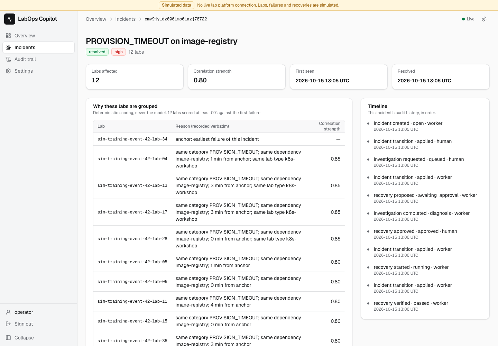
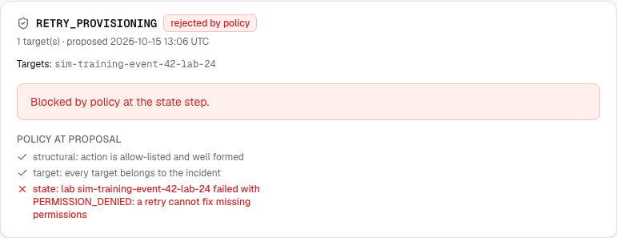
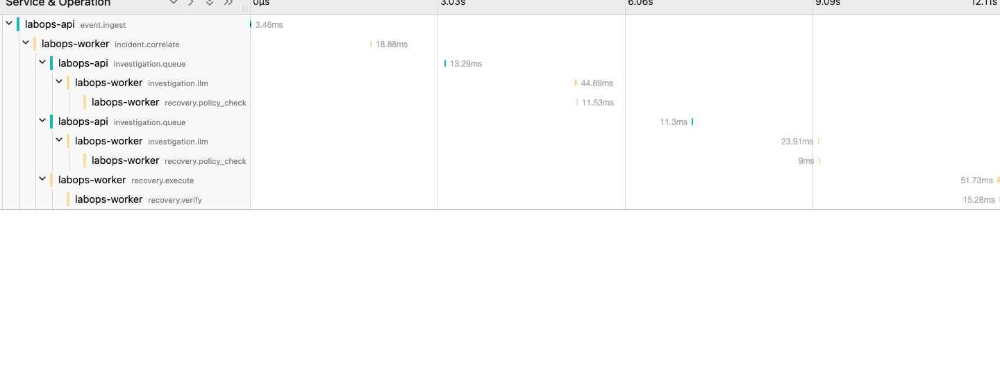

# Design

The pipeline, the safety model in technical terms, the stack, the API, and
measured numbers. The full design is [ARCHITECTURE.md](../../ARCHITECTURE.md).

## Walkthrough, technical view

The plain-language walkthrough is in the [README](../../README.md#try-it).
This is the developer view of the same run.

The seeded **training-event** scenario: 40 simulated labs, a burst of 12
provisioning timeouts on one shared image registry, scattered permission and
network failures, and one redelivered event. The same seed gives the same
labs, failures and incidents every run.

1. **Run demo scenario** on the overview. The tiles, the failure timeline and
   the labs donut fill in live; the burst is one tall bar on the timeline.
   Light and [dark](../images/dashboard-dark.png) themes follow the system.
2. **Incidents.** Deterministic correlation forms one 12-lab
   `PROVISION_TIMEOUT on image-registry` incident and keeps the 7 unrelated
   failures as separate single-lab incidents. The redelivered event is stored
   once.
3. **Open the 12-lab incident.** Each lab shows why it was included and its
   correlation strength; the timeline on the right is the incident's audit
   history.

   

4. **Investigate.** The AI analyst (a deterministic fixture by default; Gemini
   is opt-in) returns a likely cause, the evidence for it, what is missing and
   its confidence, and recommends `RETRY_PROVISIONING` on the 12 labs.
5. **Policy, then a human.** The five proposal-time policy steps pass, so the
   action waits for approval with its targets and expiry. **Approve** it: the
   worker re-runs steps 3-7 against fresh state, retries, then verifies by
   re-reading every lab. The
   incident resolves only because verification passed, and the page updates
   without a reload.
6. **The refusal.** Open a `PERMISSION_DENIED` incident and **Investigate**. The
   fixture plays an overconfident model and recommends a retry; policy blocks
   it at the state step and says why. Nothing is offered for approval.

   

7. **The audit trail** records every step, with who or what did it and when.

### Follow it through a trace and the logs

Start the stack with the opt-in trace viewer instead:

```bash
docker compose -f docker-compose.yml -f compose.tracing.yml up --build
```

Run the walkthrough, then open Jaeger at `http://localhost:16686` and search
for service `labops-worker`. The resolved incident is **one trace**: all seven
lifecycle spans, across the api and the worker, including the investigation
and approval that operators triggered minutes later from new requests.



The worker's job logs carry that trace id, and its incident lines (created,
investigation finished, execution finished) carry the incident id too, so one
search follows it through the logs:

```bash
docker compose logs worker | grep <traceId>
```

### Numbers from a real run

From one run of the scenario on an arm64 laptop (Docker, fixture model),
read from `GET /api/metrics`. Nothing here is estimated.

| Figure | p50 | Note |
|---|---|---|
| First event to incident | 2.06 s | About 2 s is the deliberate dispatch delay that lets a burst collapse into one correlation run |
| Correlation run | 10 ms | 8 runs, one per window |
| Investigation job | 29 ms | Fixture model; a real model adds its own latency |
| Recovery execution | 63 ms | Revalidate, retry, verify |
| Approval to verified | 2.14 s | The same 2 s dispatch delay, then the run |

## How it works

```
Lab simulator ──▶ Event ingestion ──▶ Deterministic correlation
                                          │
                                          ▼
                                  AI investigation
                                  (structured output,
                                   Zod validated)
                                          │
                                          ▼
                                   Policy engine  ──▶ blocked: audit the reason
                                          │
                                          ▼
                                  Human approval   ──▶ rejected
                                          │
                                          ▼
                                  BullMQ recovery job
                                          │
                                          ▼
                                  Simulated action + verification
                                          │
                                          ▼
                                  Audit trail + SSE live updates
```

A guided sequence diagram of the full lifecycle, including the deny, stale and
verification-failure branches, is in
[ARCHITECTURE.md §5](../../ARCHITECTURE.md#5-core-data-flow--the-incident-lifecycle).

---

## The safety model

The single most important design decision in this project: **the LLM is a
proposal engine, never an execution authority.**

| Concern | How it is handled |
|---|---|
| Log text containing injected instructions | Event text is passed as delimited *data*; the system policy is fixed and not model-controlled |
| Model inventing an action or a target | Output must match a strict Zod schema; actions are a closed enum; targets are intersected with server-side truth before execution |
| Unsafe or unvalidated action | A deterministic policy engine decides. The model has no path to the executor |
| Accidental execution | Only predefined, parameterised actions exist. There is no generic "run a command" path in the codebase |
| Duplicate clicks, redelivered events, worker retries | Idempotency keys and dedup keys backed by unique DB constraints; duplicates return the prior result |
| State changing between approval and execution | Preconditions are revalidated inside the execution transaction; approvals expire |
| Model failure | Non-destructive. The incident stays `open` with an audit entry |
| Secrets | Encrypted at rest, never returned by an API, redacted from logs and from AI context |
| Durable state | PostgreSQL is the source of truth. Redis is queue transport, never the record |
| Clickjacking on Approve | The web app sends `X-Frame-Options: DENY` and `frame-ancestors 'none'`, plus `nosniff`, `Referrer-Policy` and HSTS, on every response (`next.config.mjs`), so every host has them |
| Request floods | Sign-in is limited to 5 attempts a minute and investigations to 10 a minute, in Redis; both fail closed, refusing rather than allowing, if Redis is down. Behind the web server both limits are shared by all operators |

Correlation follows the same rule: **grouping is deterministic and
explainable**, not model-generated. Every lab in an incident stores why it was
included and with what signal score, and the UI renders that rationale. Raw
error strings alone never merge two failures, and single-link chaining is
blocked so unrelated failures cannot drift into one meaningless cluster.

### What structured output is actually worth

The live model runs behind a JSON-schema constraint that Gemini accepts. That
constraint is **not** the safety boundary, and we measured why rather than
assuming it.

On a live run the model returned:

```json
"evidenceAgainst": ["ev-4 lab-9: unrelated category (PERMISSION_DENIED) and no dependency specified"]
"recommendedAction": "Investigate the image-registry service stability and verify network connectivity..."
```

A full sentence where an event id belongs, and a full sentence where one of four
enum values belongs — with the schema accepted throughout. The provider enforced
**shape**. It did not enforce **values**, and it could not enforce length or
range limits at all.

Had this pipeline trusted the provider's schema as its boundary, a model would
have handed it a free-text recovery action. Zod rejected both. That is the
whole argument for keeping the boundary in our code, in one measured example
rather than a principle.

| Constraint | Provider enforces | Zod enforces |
|---|---|---|
| Field present, correct type | yes | yes |
| No unknown fields | no | yes |
| Action is one of four names | no | yes |
| Evidence ids within length | no | yes |
| Confidence within 0–1 | no | yes |
| Array bounds | yes | yes |

---

## Tech stack

| Layer | Technology | Purpose |
|---|---|---|
| Frontend | Next.js 15, React 19, TypeScript | Operator dashboard and workflows |
| Styling / UI | Tailwind CSS, shadcn/ui | Consistent interface components |
| Charts | Recharts | Failure timeline and labs-by-state donut |
| Backend | Node.js + TypeScript | All backend processing |
| HTTP API | Fastify 5 | REST endpoints and SSE |
| Validation | Zod | Request, event and LLM output schemas |
| ORM | Prisma 6 | Type-safe database access and migrations |
| Database | PostgreSQL 16 | Labs, events, incidents, evidence, approvals, audit |
| Queue | Redis 7 + BullMQ | Asynchronous investigation and recovery |
| AI | LLM API with structured outputs | Evidence-based diagnosis and action recommendation |
| Real-time | Server-Sent Events | Live dashboard updates |
| Logging | Pino | Structured logs |
| Tracing | OpenTelemetry | One trace per incident across the api and the worker |
| Metrics | SQL over committed rows | Served by `/api/metrics`; never estimated |
| Tests | Vitest, Playwright | Unit, integration and E2E |
| Delivery | Docker, Docker Compose, GitHub Actions | Reproducible environment and CI |
| Hosting | Render (one container: api, worker, web), Render Key Value, Neon PostgreSQL | The live demo; a VM stack behind Caddy is the self-hosted path (`docs/infra/DEPLOYMENT.md`) |

Node.js is the only backend runtime — no Python services. The architecture is a
modular monolith with a separate worker process rather than microservices;
`ARCHITECTURE.md §18` documents each trade-off and what would change it.

---

## Architecture

Full documentation: **[ARCHITECTURE.md](../../ARCHITECTURE.md)**

It covers design principles, system context and trust boundaries, runtime
topology, the backend module map, the incident lifecycle sequence, the data
model with DB-level invariants, lab and incident state machines, the correlation
engine and its signal weights, the AI boundary rules, the recovery safety model,
reliability and failure behaviour, observability, the lab platform integration
gate, the security model, the test architecture, deployment topology, current
implementation status, and the trade-offs taken.

## API overview

Every route needs a signed-in operator except health, sign-in (password and
Google) and the demo trigger. Request bodies, params and queries are Zod-validated; errors share one
envelope.

| Method | Endpoint | Purpose |
|---|---|---|
| `GET` | `/health` | Service and database status (public) |
| `POST` | `/api/auth/login` | Sign in; sets the session cookie; rate limited (public) |
| `GET` | `/api/auth/providers` | Whether Google sign-in is configured (public) |
| `POST` | `/api/auth/google/authorization-url` | Google's URL for a state, PKCE challenge and nonce the web issued (public) |
| `POST` | `/api/auth/google` | Exchange Google's code, verify the ID token, check the allow-list, sign in; rate limited (public) |
| `POST` | `/api/auth/logout` | Revoke the session |
| `GET` | `/api/auth/me` | The signed-in operator |
| `GET` | `/api/labs`, `/api/labs/summary`, `/api/labs/:id`, `/api/labs/:id/events` | Labs, counts by state, one lab, its events |
| `POST` | `/api/events` | Ingest an event: validated, redacted, deduplicated; 201 new, 200 duplicate |
| `GET` | `/api/incidents`, `/api/incidents/:id` | Incidents with filters; one incident with each lab's reason and score |
| `GET` | `/api/incidents/:id/audit` | The incident's full history, including steps that name it |
| `POST` | `/api/incidents/:id/investigate` | Queue an AI investigation; 202, or 200 with the active one; rate limited (10 a minute) |
| `GET` | `/api/incidents/:id/investigations` | Investigation results, newest first |
| `POST` | `/api/incidents/:id/recovery-proposals` | Propose an action; policy records allowed or blocked, with the step and reason |
| `GET` | `/api/incidents/:id/recovery-actions` | Proposals with their policy decisions and verification |
| `POST` | `/api/recovery-actions/:id/approve`, `.../reject` | Approve (202 with the execute job) or reject |
| `GET` | `/api/jobs/summary`, `/api/jobs/:id` | Background job state, from the Postgres mirror |
| `GET` | `/api/audit` | The audit trail, newest first, paginated |
| `GET` | `/api/events/stream` | Live updates (SSE): committed audit entries, resumable with `Last-Event-ID` |
| `GET` | `/api/metrics`, `/api/metrics/series` | Measured metrics and the failure timeline over a window (`hours`, max 168) |
| `GET` | `/api/integrations` | Integrations and the capabilities each has verified |
| `PUT` / `DELETE` | `/api/integrations/:provider` | Store a sealed credential (never echoed), or remove it |
| `POST` | `/api/integrations/:provider/test` | Run the adapter's own probe |
| `POST` | `/api/demo/scenarios/:name` | Run a seeded scenario; idempotent per seed; only when `DEMO_ENABLED` |

The browser never calls these. It talks only to the web app, which serves
`/auth/google/start`, `/auth/google/callback` and a relay of the live stream at
`/api/events/stream`, and calls the API server-side.

Sync, webhook and delivery endpoints for the lab platform are **not built on purpose**:
their contract is unverified (`ARCHITECTURE.md` section 13).
